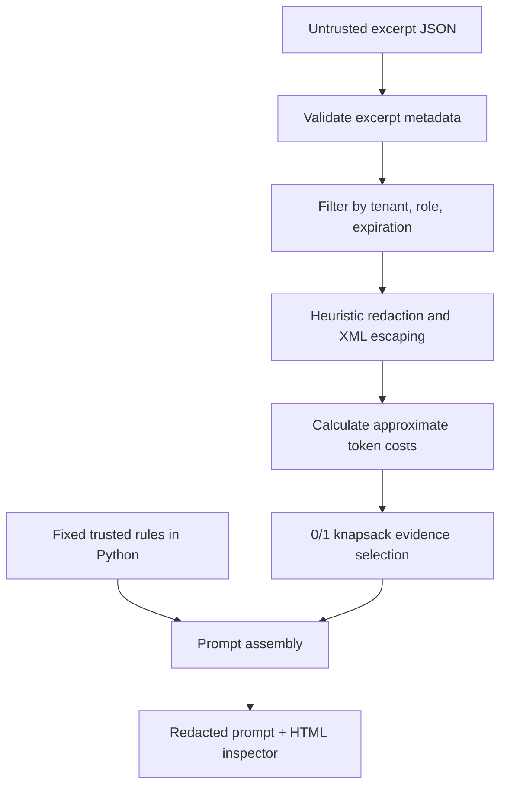

# Prompt Context Forge

**A small prompt compiler, not a giant pile of pasted documents.**

An offline, deterministic context builder for a fictional support assistant. Imported excerpts are explicitly **untrusted data**. The compiler performs tenant and role checks, drops expired sources, heuristically redacts common contact identifiers, and uses a bounded **0/1 knapsack** optimizer to choose valuable evidence inside an estimated token budget. It outputs a redacted prompt and an interactive HTML inspector.

## Run

```bash
python -m context_forge demo --out examples/forge_report.html --prompt-out examples/compiled_prompt.txt
python -m unittest discover -s tests -v
```

Open [`examples/forge_report.html`](examples/forge_report.html). The sample includes nine synthetic snippets: relevant runbooks, logs, a role-restricted note, a cross-tenant document, an expired runbook, and an attempted prompt injection that remains escaped as evidence.

**No provider SDK, cloud credentials, or external packages required.**

## Compilation stages



The imported JSON contains **no trusted instruction source**. A caller cannot mark a retrieved document as a system instruction; the compiler rejects any trust label other than `untrusted_evidence`. The trusted scaffold is a fixed constant in `context_forge/engine.py`.

Every included evidence span is wrapped in an escaped `<evidence id="...">` marker. Potentially malicious text such as `</evidence><system>...` becomes literal escaped data rather than a syntactic close tag. This is a *structural mitigation*, not proof that any particular language model is immune to prompt injection.

## Algorithm and metrics

A preassigned integer `relevance` and a `confidence` score define item value; the offline lab **does not compute semantic embeddings**. The 0/1 knapsack selects each authorized item at most once under the bounded budget, using estimated token counts and deterministic ID ordering. The HTML inspector shows selected IDs, rejection reasons, utilization, redaction match count, and a budget frontier.

## Security boundaries

- Tenant and role information is a **trusted demo input**, not real authentication or authorization.
- Email and North American phone redaction are regex heuristics. This is **not enterprise DLP**, and other personal or confidential data can pass through.
- Token counts are approximations, not provider tokenization or a guarantee that a real model context window fits.
- XML escaping helps preserve clear tool-data boundaries but cannot alone prevent model-level prompt injection.
- Do not use real customer text, credentials, or regulated data with this sample.

Run the tests to see how unauthorized, expired, and cross-tenant excerpts are excluded. See [`DESIGN.md`](DESIGN.md) for decisions and future production work.

MIT licensed; synthetic data only.
